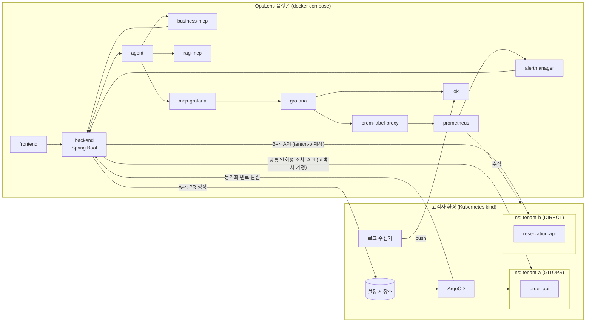
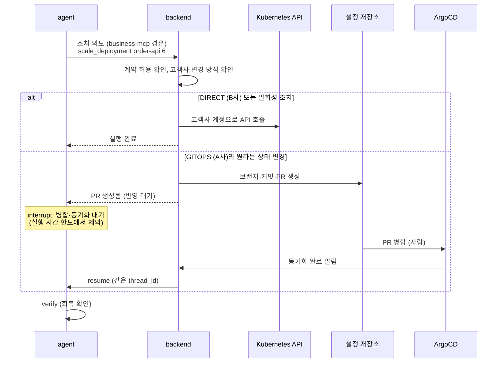
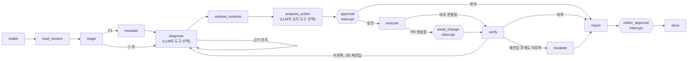

# OpsLens 기획안: MSP용 멀티 고객사 장애 대응 Agent

> 작성일: 2026-10-19 · 상태: 초안 v3 (고객사 인프라 조치와 혼합 실행 환경 반영, 팀 인원·기간 미정)
>
> v3 변경 이유와 근거: [ADR 0001 고객사 인프라 조치와 혼합 실행 환경](adr/0001-tenant-infra-actions-hybrid-environment.md)

## 1. 프로젝트 개요

| 항목 | 내용 |
|---|---|
| 가칭 | **OpsLens**: MSP용 멀티 고객사 장애 대응 Agent |
| 한 줄 소개 | 고객사 장애 알림이 들어오면 Agent가 **그 고객사의 SLA 계약과 런북에 맞춰** 진단하고, 사람의 승인을 받아 **그 고객사의 운영 방식(GitOps 또는 직접 운영)으로** 조치하고, 고객사 보고까지 처리한다. 고객사 사이의 데이터와 권한은 격리한다 |
| 대상 | **B2B**. MSP(운영 대행사)가 고객이고, MSP 엔지니어가 쓰며, MSP의 고객사 담당자는 자기 회사 리포트를 본다 |
| 구축 환경 | OpsLens 플랫폼: **Docker Compose** · 고객사 환경(조치 대상): **Kubernetes(kind) + ArgoCD** |
| 기술 스택 | Vue 3, Spring Boot 3, FastAPI + LangGraph 1.x + LangChain 1.x, FastMCP 4.1, PostgreSQL 16 + pgvector, Kafka(KRaft), Prometheus·Loki·Grafana, LangSmith, kind, ArgoCD |
| Agent 구현 방식 | PDF의 **A안: 직접 만든 LangGraph StateGraph** |

## 2. 문제 정의

- MSP 엔지니어 한 명이 고객사 여러 곳을 맡는다. 고객사마다 **SLA 등급, 런북, 연락 체계, 허용되는 조치, 변경 반영 방식**이 다르다.
  - 예: A사는 ArgoCD로 GitOps를 하고 모든 변경을 PR로 받는다. B사는 운영자가 클러스터를 직접 다룬다.
- 장애가 동시에 여러 건 나면 어떤 고객사부터 처리할지 사람이 계약서를 떠올리며 판단한다.
- AI Agent를 고객사 환경에 투입하면 **권한, 고객사 간 데이터 격리, 책임 추적** 문제가 생긴다. 업계에서도 미해결 과제로 꼽힌다.

**목표:** 고객사 계약 맥락을 아는 1차 대응(진단 → 조치 제안 → 고객사 방식으로 반영 → 보고)을 Agent가 맡고, **격리·승인·감사는 구조적으로 보장**한다.

### 경쟁 제품 대비 차별점

조사 근거는 [ADR 0001](adr/0001-tenant-infra-actions-hybrid-environment.md) 1.2절에 있다.

| 구분 | 대표 제품 | 조치 범위 | OpsLens |
|---|---|---|---|
| AI SRE (진단 중심) | AWS DevOps Agent, Datadog Bits AI | 원인 분석·완화 계획, 실행은 사람 | 진단에 더해 **승인 후 실제 조치와 회복 확인** |
| AI SRE (조치 실행) | Komodor Klaudia, PagerDuty SRE Agent | 단일 조직의 Kubernetes·런북 조치 | **고객사마다 다른 계약·허용 조치·변경 방식** |
| MSP 도구 | NinjaOne Katana AI, ConnectWise | 엔드포인트(PC·서버) 스크립트 복구 | **서비스 장애 + SLA 우선순위** |
| 공통 공백 | — | 멀티 테넌트 거버넌스 | **고객사별 자격증명, 테넌트 격리 Guardrail, 고객사별 승인·감사** |

## 3. 시스템 구성

두 영역으로 나눈다. **OpsLens 플랫폼**은 MSP가 운영하는 시스템이고, **고객사 환경**은 조치 대상을 흉내 낸 것이다(ADR 0001 D5).

### 3.1 OpsLens 플랫폼 (docker compose)

| 서비스 | 기술 | 역할 | 포트 | 공개 |
|---|---|---|---|---|
| frontend | Vue 3 + nginx | 인시던트 목록, 진행 상황(SSE), 근거 패널, 승인 카드, 고객사 포털 | 80 | O |
| backend | Spring Boot 3 | 인증(JWT), 업무 API, 작업 API(202), SSE 중계, `/internal/**`, SLA 계산 등 **업무 규칙 전부**, **고객사별 조치 반영(GitOps PR 또는 직접 API)** | 8080 | O |
| agent | FastAPI + LangGraph | Harness, 장애 대응 Graph, Kafka consumer, 승인·반영 대기와 재개 | 8000 | X |
| business-mcp | FastMCP (직접 구현) | 고객사·SLA·인시던트 조회 도구와 변경 도구. `/internal/**` 호출 | 9101 | X |
| rag-mcp | FastMCP (직접 구현) | 고객사별 계약서·런북·포스트모템 검색, 원문 Resource | 9102 | X |
| mcp-grafana | 기존 이미지 | Prometheus·Loki 조회 (조회 도구만 허용) | 9103 | X |
| indexer | Python 작업 | 문서 Chunking → Embedding → Indexing (오프라인, 재색인은 비동기 작업) | — | X |
| postgres | PostgreSQL 16 + pgvector | 업무 데이터, 작업 이력, checkpointer·store, 문서 벡터 (스키마·계정 분리) | 5432 | X |
| kafka | Apache Kafka (KRaft 모드) | 작업 토픽(SLA 등급별), retry·DLT 토픽 | 9092 | X |
| prometheus, prom-label-proxy, loki, alertmanager | 기존 이미지 | 고객사 환경의 메트릭·로그 수집, 알림 발생, 고객사별 조회 범위 강제 | — | X |
| grafana | 기존 이미지 | mcp-grafana의 데이터 창구. UI는 개발 프로필에서만 연다 | 3000 | X |

LLM API 키는 `.env`에만 두고, 외부 LLM은 agent만 HTTPS로 호출한다. v2의 `demo-app-a`, `demo-app-b`는 compose에서 빠지고 고객사 환경으로 옮긴다.

### 3.2 고객사 환경 (Kubernetes kind)

| 구성 요소 | 내용 |
|---|---|
| 클러스터 | kind 클러스터 1개. compose와 같은 Docker 네트워크에 붙여 backend가 API 서버를 호출한다 |
| 네임스페이스 | 고객사마다 하나: `tenant-a`, `tenant-b` |
| 서비스 | A사 `order-api`, B사 `reservation-api` (기존 demo-app 이미지를 Deployment로 배포) |
| ArgoCD | `tenant-a`만 관리한다. 설정 저장소의 매니페스트와 클러스터를 동기화하고, 동기화가 끝나면 backend에 알린다 |
| 설정 저장소 | A사의 Kubernetes 매니페스트(Deployment 레플리카 수, 이미지 버전, 설정값). **이 프로젝트 저장소의 `gitops/tenants/tenant-a/`** 경로이며, ArgoCD는 GitHub `main`의 이 경로만 본다. 클러스터 구성은 `gitops/cluster/`, B사 초기 배포는 `gitops/tenants/tenant-b/`(ArgoCD 미관리) |
| 고객사별 권한 | 네임스페이스마다 ServiceAccount와 Role. 그 네임스페이스의 파드 재시작·Deployment 확장만 허용한다. 실제 클라우드의 고객사별 역할(AssumeRole)에 해당한다 |
| 관측 수집 | Prometheus가 kind 안의 서비스를 수집한다(tenant 라벨 부착). 클러스터 안의 로그 수집기가 Loki로 보낸다(고객사별 조직 ID) |

### 3.3 조치 반영 방식 (ADR 0001 D3·D4)

고객사 프로필에 **변경 방식**(`GITOPS` 또는 `DIRECT`)을 둔다. Agent는 조치 의도만 정하고, backend가 고객사별로 반영 경로를 고른다.

| 조치 | 종류 | A사 (GITOPS) | B사 (DIRECT) |
|---|---|---|---|
| `restart_pods` 파드 재시작 | 일회성 (원하는 상태 그대로) | API로 바로 실행 | API로 바로 실행 |
| `scale_deployment` 레플리카 변경 | 원하는 상태 변경 | **설정 저장소 PR** → 병합 → 동기화 | API로 바로 실행 |
| `rollback_deployment` 이미지 롤백 | 원하는 상태 변경 | **설정 저장소 PR**(이미지 태그 되돌리기) → 병합 → 동기화 | API로 바로 실행 |

- 조치 허용 여부(계약)와 반영 방식은 모두 backend가 판단한다. Agent와 MCP 도구는 반영 방식을 모른다.
- 고객사 자격증명(ServiceAccount 토큰, Git 토큰)은 backend만 가진다. Agent는 자격증명을 보지 못한다.
- CLI(`kubectl`, `aws`, `gcloud`)를 셸로 실행하지 않고 API 클라이언트로 호출한다.
- 실제 AWS·GCP는 다루지 않는다. 같은 구조에 클라우드 어댑터를 추가하는 설계로만 설명한다(14장).

### 3.4 PostgreSQL 스키마와 계정 분리

| 스키마 | 내용 | 쓰기 계정 | 읽기 계정 |
|---|---|---|---|
| `app` | 고객사(변경 방식 포함), 계약, 인시던트, 작업 이력, 감사 로그 | backend | backend |
| `agent` | LangGraph checkpointer, store(장기 기억) | agent | agent |
| `docs` | 문서 chunk, Embedding, 출처 메타데이터 | indexer | rag-mcp |

agent와 rag-mcp는 `app` 스키마에 접근할 수 없다. "Agent는 DB 직접 쓰기 금지"와 "업무 데이터는 Spring Boot만"을 계정 권한으로 강제한다.

### 3.5 데모 고객사

- **A사, 온라인 쇼핑몰:** Gold 등급. 가용성 99.9%, 15분 내 응답. 주문 서비스 운영. **GitOps(ArgoCD)** 로 운영하고 원하는 상태 변경은 PR로만 받는다. 허용 조치: 재시작, 확장, 롤백
- **B사, 예약 플랫폼:** Silver 등급. 가용성 99.5%, 1시간 내 응답. 외부 결제 API 사용. **직접 운영**. 허용 조치: 재시작만 (확장·롤백은 고객사 승인 필요, 계약서 제3조)

### 3.6 레퍼런스 금지 사항 준수 (표 5-4, 5-6)

| 구성 요소 | 금지 사항 | OpsLens에서 지키는 방법 |
|---|---|---|
| Vue 3 | 권한 판단, AI 서버 직접 호출 | 권한은 backend가 판단하고, 화면은 `/api/**`와 SSE만 호출 |
| Spring Boot | LLM 호출 | LLM은 agent만 호출 |
| FastAPI Agent | DB 직접 쓰기 | `app` 스키마 접근 권한 없음. 결과와 상태는 backend 내부 API로 전달 (checkpointer는 레퍼런스상 예외). 고객사 자격증명도 없다 |
| business-mcp | 업무 규칙 복제 | SLA 기한·크레딧 계산, 조치 허용 여부, 반영 방식 선택은 backend가 하고, MCP는 호출만 |
| rag-mcp | 업무 데이터 변경 | `docs` 스키마 읽기 전용 계정 |

## 4. 데이터 흐름

### 4.1 알림으로 시작하는 흐름

1. 시나리오 스크립트가 고객사 환경에 장애를 만든다(10장).
2. Alertmanager가 backend의 **`/internal/alerts`**(docker network 내부, webhook 토큰 필요)를 호출한다.
3. backend가 고객사를 식별하고 **인시던트와 AI 작업(taskId)을 만든 뒤**, SLA 등급에 맞는 토픽(`tasks.gold`, `tasks.silver`)에 발행한다. 메시지 키는 `tenant_id`, 헤더에 `task_id`, `trace_id`를 싣는다.
4. agent consumer가 메시지를 꺼내 **worker pool**에 넘긴다. Graph는 poll 루프 밖에서 실행된다.
5. agent는 진행 이벤트를 backend `/internal/tasks/{id}/events`로 보내고, backend가 SSE로 화면에 중계한다.
6. 변경 도구 앞에서 interrupt가 걸리면 checkpointer에 저장하고 `APPROVAL_REQUIRED`를 보낸다. **이 시점에 Kafka 오프셋을 커밋**한다. 승인 대기가 consumer를 막지 않는다.
7. 담당 엔지니어가 `POST /api/ai/tasks/{id}/approval`을 보낸다. backend가 **승인자 역할과 담당 고객사를 검증**하고 승인 기록을 저장한 뒤, agent `/agent/tasks/{id}/resume`을 호출한다. agent는 같은 `thread_id`로 재개한다. 재개는 Kafka를 거치지 않는다.
8. 조치를 고객사 방식으로 반영한다(4.4). 회복 확인 → 보고서 작성 순으로 진행한다. agent는 결과를 `DONE` 이벤트와 `/internal/tasks/{id}/result`로 넘기고, **보고서 저장은 backend가 한다**.
9. 고객사 담당자는 포털에 로그인하면 **자기 회사의 인시던트와 보고서만** 본다. 필터링은 backend가 한다.

### 4.2 사람이 직접 묻는 흐름

"A사 지금 왜 느려?" 같은 질문은 `POST /api/ai/tasks`로 접수하고 **202 + taskId**를 바로 받는다. 그다음은 3번부터 같은 경로를 탄다.

### 4.3 동기 경로와 비동기 경로 (표 5-7)

| 경로 | 해당 요청 | 응답 |
|---|---|---|
| 동기 | 인시던트·고객사 조회, 작업 상태 조회, 승인·거절 기록 | 바로 답한다 |
| 비동기 | Agent 진단, 승인 후 재개, 반영 완료 후 재개, 문서 재색인, 일괄 리포트 | 202 후 SSE 이벤트 |

### 4.4 조치 반영 흐름

- GitOps 고객사에서는 **OpsLens 승인 = PR 생성 허가**, **PR 병합 = 고객사 GitOps 절차의 승인**이다. 데모에서는 MSP 엔지니어가 병합한다.
- 병합·동기화를 기다리는 시간은 승인 대기처럼 다룬다. checkpointer에 저장하고 멈추며, 실행 시간 한도에 넣지 않는다.
- 일정 시간(기본 30분) 안에 병합되지 않으면 에스컬레이션한다.

## 5. API 계약

### 5.1 화면이 호출하는 AI 작업 API (표 5-8)

| Method | Path | 설명 | 응답 |
|---|---|---|---|
| POST | `/api/ai/tasks` | 질문으로 작업을 만든다 | 202 taskId |
| GET | `/api/ai/tasks/{id}` | 상태와 결과를 조회한다 | status, answer, sources |
| GET | `/api/ai/tasks/{id}/stream` | 진행 이벤트를 받는다 | text/event-stream |
| POST | `/api/ai/tasks/{id}/approval` | 승인·거절을 보낸다 | 202 |
| GET | `/api/ai/tasks?mine=true` | 내 작업 이력 | 목록 |

### 5.2 화면이 호출하는 업무 API (동기)

| Method | Path | 설명 |
|---|---|---|
| POST | `/api/auth/login` | 로그인, JWT 발급 (SSE용 쿠키 포함) |
| GET | `/api/incidents` | 인시던트 목록 (역할·담당 고객사로 필터) |
| GET | `/api/incidents/{id}` | 인시던트 상세와 보고서 |
| GET | `/api/tenants/me` | 고객사 담당자의 자기 회사 정보 |

### 5.3 진행 이벤트 (표 5-9)

| 이벤트 | 언제 | 화면 표현 |
|---|---|---|
| `TOKEN` | 답변 생성 중 | 답변 영역에 이어서 표시 |
| `TOOL_START`, `TOOL_END` | MCP 도구 실행 전후 | "A사 에러율 조회 중…" 상태 표시 |
| `APPROVAL_REQUIRED` | 변경 도구 앞에서 멈춤 | 승인 카드 (도구, 인자, 근거, 영향, **반영 방식**) |
| `CHANGE_PENDING` | GitOps PR을 만들고 병합을 기다림 | PR 링크와 대기 상태 |
| `DONE`, `FAILED` | 작업 종료 | 스트림 닫고 목록 갱신. FAILED는 trace 링크 표시 |

`CHANGE_PENDING`은 v3에서 추가한 이벤트다(PDF 표 5-9에는 없음).

### 5.4 내부 API (docker network 안에서만, 서비스 토큰 필요)

| 호출하는 쪽 → 받는 쪽 | Path | 용도 |
|---|---|---|
| alertmanager → backend | `/internal/alerts` | 알림 수신, 인시던트·작업 생성 |
| business-mcp → backend | `/internal/tenants/{tenant}` 아래 `/sla`, `/services`, `/incidents`, `/oncall`, `/incidents/{id}/escalate`, `/actions`, `/notices`, `/sla-credits` | 조회·변경 도구의 실제 처리. 경로의 고객사와 `X-Tenant-Id`가 다르면 거부 |
| agent → backend | `/internal/tasks/{id}/events`, `/internal/tasks/{id}/result` | 진행 이벤트, 최종 결과 |
| backend → agent | `/agent/tasks/{id}/run`, `/agent/tasks/{id}/resume` | 큐 없는 경로(MVP)의 작업 실행, 승인·반영 완료 후 재개 |
| ArgoCD → backend | `/internal/gitops/sync-events` | 동기화 완료 알림 (ArgoCD Notifications webhook) |
| backend → Kubernetes API | 고객사 ServiceAccount로 호출 | 파드 재시작, Deployment 확장·롤백 (DIRECT 고객사, 일회성 조치) |
| backend → 설정 저장소 API | 고객사 저장소 토큰으로 호출 | 브랜치·커밋·PR 생성, 병합 상태 조회 (GITOPS 고객사) |

## 6. Agent 설계 (LangGraph StateGraph, A안)

| Node | 종류 | 하는 일 |
|---|---|---|
| intake | 코드 | tenant_id, incident_id, task_id를 확정한다. **tenant_id는 backend가 넘긴 컨텍스트에서 오고 모델이 바꿀 수 없다** |
| load_context | 코드 | `get_tenant_profile`, `get_sla_terms`로 SLA 등급, **backend가 계산한 응답 기한**, 담당자, 변경 방식을 가져온다 |
| triage | 코드 | backend가 준 심각도와 기한으로 분기한다. P1이면 에스컬레이션부터 한다. 기한은 Agent가 직접 계산하지 않는다 |
| diagnose | **LLM** | 허용목록(메트릭·로그 조회, 인시던트 이력, 최근 배포 이력) 안에서 **모델이 도구를 골라** 이상 시작 시점 → 해당 시간대 ERROR 로그 → 직전 배포와의 관계 → 원인 후보를 찾는다 |
| retrieve_runbook | 코드 + RAG | 해당 고객사의 런북·포스트모템을 검색하고, 장기 기억(store)에서 비슷한 과거 인시던트를 불러온다 |
| propose_action | **LLM** | 런북 조항과 메트릭 근거로 조치안을 만들고, **모델이 변경 도구와 인자를 고른다**. 반영 방식은 정하지 않는다 |
| approval, notice_approval | interrupt | checkpointer에 저장하고 사람의 결정을 기다린다 |
| execute | 코드 | 승인된 변경 도구를 business-mcp로 호출한다. 결과가 "PR 생성됨"이면 await_change로 간다 |
| await_change | interrupt | GitOps PR의 병합과 동기화를 기다린다. backend가 동기화 완료 알림을 받으면 재개한다. 실행 시간 한도에서 제외한다 |
| verify | **LLM** | 조치 후 메트릭을 다시 조회해 회복 여부를 **자기 검증**한다 |
| report | **LLM** | 요약, 근거(출처 포함), 추정 원인, 조치와 반영 방식(PR 링크 포함), 조사 과정, SLA 영향(backend 계산값)을 작성한다 |

**State:** `task_id`, `tenant_id`, `incident_id`, `sla_tier`, `deadline`, `plan[]`, `findings[]`, `evidence[]`, `proposed_actions[]`, `approvals[]`, `change`(반영 방식, PR 주소, 상태), `attempts`, `turns`, `messages`, `trace_id`

### Agentic 요소

| 요소 | OpsLens에서 |
|---|---|
| 계획 (Planning) | diagnose 시작 시 조사 계획(`plan[]`)을 세우고 단계마다 갱신한다 |
| 도구 사용 (Tool Use) | diagnose, propose_action에서 모델이 허용목록 안의 도구를 고른다 |
| 반성 (Reflection) | verify에서 조치 결과를 스스로 확인하고, 실패하면 진단으로 돌아간다 |
| 기억 (Memory) | 단기: checkpointer(thread 단위). 장기: 해결된 인시던트 요약을 고객사별 store에 쌓아 다음 진단에 쓴다 |
| 사람 협업 (HITL) | 변경 도구와 고객 공지는 interrupt 후 승인. GitOps 고객사는 PR 병합까지 사람이 한다 |

## 7. MCP 설계

### 7.1 연결 방식 (표 4-2)

| 상황 | 방식 | 주소 |
|---|---|---|
| 도구 단위 테스트 | 인메모리 Client | 테스트 코드에서 Server 객체를 직접 연결 |
| 로컬 개발 | stdio | `Client(Path(".../server.py"))` |
| docker compose | **Streamable HTTP** | `http://business-mcp:9101/mcp`, `http://rag-mcp:9102/mcp`, `http://mcp-grafana:9103/mcp` |

agent는 `langchain-mcp-adapters`의 `MultiServerMCPClient` 하나로 세 Server를 묶고, LangChain 도구 변환도 이 라이브러리가 한다. 도구 이름에 `business_`, `rag_`, `grafana_` 접두어가 붙는다(`tool_name_prefix=True`).

- 버전 조합: MCP Server는 FastMCP 4.1.1(mcp 2.x), agent는 langchain-mcp-adapters 0.3.2(mcp 1.x)를 쓴다. 같은 환경에는 함께 설치할 수 없지만 컨테이너가 달라서 문제없다.
- FastMCP 4.1 Server는 이전 연결 절차(`initialize`)도 받아서 통신이 된다(2026-10-19 확인). 그래서 agent 쪽 연결은 PDF의 `server/discover`가 아니라 `initialize`로 이뤄진다. 매 요청 헤더에 `X-Tenant-Id`, `X-Task-Id`, `X-Trace-Id`, 서비스 토큰을 싣는다.

### 7.2 business-mcp

Spring Boot `/internal/**`만 호출하고 DB에는 접근하지 않는다. **업무 규칙(SLA 기한·크레딧 계산, 조치 허용 여부, 반영 방식 선택, 고객사 소유권 검증)은 전부 Spring Boot에 있다.**

| 구분 | 도구 | 설명 (docstring 요지) | 힌트 |
|---|---|---|---|
| 조회 | `get_tenant_profile` | 고객사 이름, SLA 등급, 담당자, 허용 조치, 변경 방식 | readOnlyHint |
| 조회 | `get_sla_terms` | 가용성 목표(%), 응답 기한(분), backend가 계산한 남은 시간 | readOnlyHint |
| 조회 | `list_incidents` | 최근 인시던트와 상태, 기간 필터 | readOnlyHint |
| 조회 | `get_oncall_contacts` | 에스컬레이션 대상 | readOnlyHint |
| 조회 | `get_service_inventory` | 고객사 서비스 목록, 의존성, 현재 레플리카 수와 이미지 버전 | readOnlyHint |
| 조회 | `list_recent_changes` | 최근 배포·설정 변경 이력 (GitOps는 커밋, 직접 운영은 Deployment 이력) | readOnlyHint |
| 변경 | `create_incident`, `escalate_incident` | 인시던트 생성, 담당자 호출 | destructiveHint, 승인 |
| 변경 | `execute_runbook_action` | 허용목록 조치만: `restart_pods`, `scale_deployment`(replicas), `rollback_deployment`(이전 버전). 반영 방식은 backend가 정한다. 결과는 "실행됨" 또는 "PR 생성됨(주소)" | destructiveHint, 승인 |
| 변경 | `send_customer_notice` | 고객사 공지 발송 | destructiveHint, 승인(MSP_ADMIN) |
| 변경 | `confirm_sla_credit` | backend가 계산한 크레딧 확정 | destructiveHint, 승인(MSP_ADMIN) |

**오류 처리:** 실패는 `ToolError`로 돌려주고, 메시지에 재시도에 필요한 정보를 넣는다.

- 예: `"'payment-api'는 A사 서비스가 아니다. A사 서비스: order-api"`
- 예: `"scale_deployment는 B사 계약상 허용되지 않는다. 허용 조치: restart_pods, notice"`

### 7.3 rag-mcp

- 도구 `search_documents(query, doc_type?)`: chunk와 출처(문서, 조항, 버전)를 돌려준다. 고객사 필터는 **요청 헤더의 tenant로 서버가 강제 적용**하고, 모델 인자로는 바꿀 수 없다.
- Resource `docs://{tenant}/{doc_id}`: 근거 패널이 원문을 읽는다. 요청 tenant와 다르면 거부한다.
- Prompt(선택): `postmortem_draft(incident_id)`. 사용자가 고르는 포스트모템 초안 템플릿이다.

### 7.4 색인 파이프라인 (indexer)

| 단계 | 처리 |
|---|---|
| Documents | 고객사별 SLA 계약서, 런북, 포스트모템 (가상 작성, Markdown) |
| Chunking | 조항 단위로 자른다 |
| Embedding | 질문 검색과 같은 모델로 벡터화하고, 모델 이름과 차원을 메타데이터에 남긴다 |
| Indexing | `docs` 스키마에 tenant, 문서 버전, 출처와 함께 저장한다 |

재색인은 `POST /api/ai/tasks`(type=reindex)로 접수하는 비동기 작업이다. v3에서는 런북에 인프라 조치(재시작·확장·롤백)와 GitOps 절차 조항을 추가한다.

### 7.5 mcp-grafana (관측 데이터 조회)

Grafana Labs가 공개한 기존 MCP Server([grafana/mcp-grafana](https://github.com/grafana/mcp-grafana))를 그대로 쓴다. 직접 구현하지 않는다.

| 항목 | 설정 |
|---|---|
| 이미지 | `grafana/mcp-grafana` (기본 실행 모드가 SSE이므로 전송 방식을 직접 지정한다) |
| 실행 인자 | `-t streamable-http --address 0.0.0.0:9103 --allowed-hosts mcp-grafana:9103 --disable-write` + 필요 없는 카테고리 비활성화 |
| 엔드포인트 | `http://mcp-grafana:9103/mcp` (기본 경로 `/mcp`) |
| 호출자 인증 | `MCP_GRAFANA_SERVER_TOKEN`(= 서비스 토큰). agent가 Bearer 토큰을 실어야 한다 |
| Grafana 인증 | `GRAFANA_URL`과 Grafana 계정 (TODO: Viewer 권한 서비스 계정 토큰으로 교체) |
| 허용 도구 | `query_prometheus`, `query_prometheus_histogram`, `list_prometheus_label_values`, `query_loki_logs`, `query_loki_patterns`, `query_loki_stats` |

- **조회 도구만** 쓴다. 서버 옵션 `--disable-write`로 쓰기 도구를 끄고, Harness 허용목록으로 한 번 더 막는다. Grafana API를 임의로 호출하는 `grafana_api_request` 같은 도구도 허용목록에 없어서 쓸 수 없다.
- 고객사별 Grafana 데이터소스를 둔다.
  - Loki: 고객사마다 `X-Scope-OrgID` 멀티테넌시
  - Prometheus: `prom-label-proxy`로 tenant label을 강제
- Harness는 쿼리 문자열을 검사하지 않는다. 대신 **datasource UID(`datasourceUid` 인자)를 현재 고객사의 것으로 강제**한다. 문자열 검사보다 우회가 어렵다.
- 연동이 막히면 Prometheus·Loki API를 감싼 obs-mcp를 직접 만든다(15. 리스크).

## 8. Harness 적용

### 8.1 구성 요소별 적용 (표 6-3)

| 구성 요소 | 적용 위치 | OpsLens 기준 |
|---|---|---|
| Instructions | `prompts/*.md` (git 버전 관리) | 역할, 조사 순서, 도구 사용 규칙, 금지 사항(다른 고객사 언급·추측 수치 금지), 리포트 출력 형식 |
| Tools | MCP Client → LangChain 도구 변환 | Node별 허용목록, 결과는 4,000자로 자름, 오류는 ToolMessage로 모델에 전달 |
| Agent Loop | StateGraph | 모델 호출 최대 8턴, 같은 도구 3회까지, **실행 시간 120초(승인·반영 대기 시간은 제외하고 구간별로 측정)** |
| Context | 메시지 정리·RAG 주입 | Token 예산을 두고, **넘으면 오래된 도구 결과와 대화를 요약**한다. 로그는 대표 메시지와 건수로 집계해 넣는다 |
| State·Memory | PostgreSQL checkpointer·store | thread_id 단위 저장, 승인·반영 대기 후 그대로 재개, 고객사별 장기 기억 |
| Guardrails | approval Node + 도구 래퍼 + backend | 변경 도구 interrupt. **테넌트 격리**(헤더 강제, datasource 강제, 문서 필터). **조치 권한 이중 제한**(backend의 계약 허용목록 + 고객사 네임스페이스 RBAC). 도구 결과의 이메일·전화번호·토큰 마스킹. 로그 속 지시문은 데이터로만 취급(프롬프트 주입 차단) |
| Recovery | 모델 호출·agent·Kafka | 429·503은 2회 재시도 후 대체 모델, 그래도 실패하면 FAILED. 작업 실패는 `tasks.retry` → 3회 실패 시 `tasks.dlt`. agent가 재시작되면 checkpointer에서 재개. PR이 30분 안에 병합되지 않으면 에스컬레이션 |
| Observability | LangSmith + 로그 | trace_id 하나를 Kafka 헤더, 로그, MCP 헤더, LangSmith, **PR 본문**에 실어 연결. Node·도구·Token·지연·비용 기록, tenant 태그. FAILED 작업은 trace 링크를 작업 이력에 저장. 한도 초과·재시도·대체 모델 건수 집계 |

8턴이나 120초가 부족하면 값을 조정하고 **Harness 명세**(`docs/harness-spec.md`)에 바꾼 값과 이유를 남긴다.

### 8.2 요소별 테스트 (요소마다 1개 이상)

| 구성 요소 | 테스트 | 기대 결과 |
|---|---|---|
| Instructions | 프롬프트 버전을 바꾼 뒤 평가셋 재실행 | 전후 결과표 생성 |
| Tools | 20,000자 로그 결과, 존재하지 않는 서비스 조회 | 4,000자로 잘림, ToolError 메시지로 재시도 성공 |
| Agent Loop | 원인을 찾을 수 없는 시나리오 | 8턴에서 종료, "원인 미확정" 보고와 에스컬레이션 |
| Context | 긴 대화로 Token 예산 초과 | 요약 후 계속 진행, 예산 이내 유지 |
| State·Memory | 승인 대기·PR 병합 대기 중 agent 컨테이너 재시작 | 승인·병합 후 같은 thread_id로 이어서 실행 |
| Guardrails | B사 컨텍스트에서 A사 datasource·문서·네임스페이스 요청, 로그에 주입 문구, 승인 없이 변경 도구 호출, B사에 확장 조치 요청 | 모두 거부, 감사 로그 기록 |
| Recovery | LLM 503 모킹, rag-mcp 중단, PR 미병합 | 재시도 후 대체 모델, 3회 실패 시 DLT와 FAILED + trace 링크, 30분 후 에스컬레이션 |
| Observability | 시나리오 A 1회 실행 | trace_id 하나로 Kafka·로그·LangSmith·PR이 이어져 조회됨 |

## 9. 인증과 권한

### 9.1 사용자 인증과 역할

backend가 JWT를 발급한다. SSE는 `EventSource`가 헤더를 못 싣기 때문에 HttpOnly 쿠키로 인증한다.

| 역할 | 권한 |
|---|---|
| MSP_ADMIN | 모든 고객사 조회, 고객사 공지 발송 승인, SLA 크레딧 확정 |
| MSP_ENGINEER | 배정된 고객사만 조회, 조치 승인 |
| TENANT_VIEWER | 자기 회사의 인시던트와 보고서만 조회 |

조치 승인과 공지 승인을 다른 역할로 나눠 **직무 분리**를 보여준다. 승인 요청이 오면 backend가 "이 사용자가 이 고객사의 이 도구를 승인할 수 있는가"를 매번 검증한다.

### 9.2 서비스 간 인증과 테넌트 전달

- `/internal/**`와 `/agent/**`는 docker network 안에서만 열리고, **서비스 토큰**이 없으면 거부한다.
- 테넌트 정보 경로: backend(작업 생성) → Kafka 헤더 또는 내부 HTTP → agent State → MCP 요청 헤더 → backend `/internal/**`
- backend는 `/internal/**` 요청마다 tenant 소유권을 **다시 검증**한다. 중간 단계를 믿지 않는다.

### 9.3 고객사 자격증명

| 자격증명 | 범위 | 보관 |
|---|---|---|
| Kubernetes ServiceAccount 토큰 | 해당 고객사 네임스페이스의 파드 재시작·Deployment 확장·롤백만 | backend에만 마운트 (DB와 agent에는 없음) |
| 설정 저장소 토큰 | 이 저장소의 브랜치·PR 생성만 (직접 push to main 불가). backend가 PR의 변경 경로를 `gitops/tenants/<tenant>/`로 제한한다 | backend에만 마운트 |

- 조치할 때 backend는 **작업의 고객사에 해당하는 자격증명만** 꺼낸다. A사 작업에 B사 자격증명이 쓰일 수 없다.
- 실제 클라우드라면 고객사 계정의 역할을 임시로 빌리는 방식(AssumeRole)이 같은 자리에 들어간다.

## 10. 데모 시나리오

| 시나리오 | 고객사 (방식) | 장애 만들기 | Agent가 내야 할 결론과 행동 |
|---|---|---|---|
| A. 잘못된 배포 | A사 (GITOPS) | `gitops/tenants/tenant-a/`에 커넥션 풀 크기(`DEMO_POOL_SIZE`)를 20 미만으로 줄이는 커밋 → ArgoCD 반영 → 에러율 50% | "직전 배포 이후 커넥션 풀 고갈로 5xx 급증". 런북 조항을 근거로 **롤백 PR**(해당 커밋 되돌리기) 제안 → 승인 → PR 생성 → 병합 → 동기화 → 회복 확인 |
| A2. 트래픽 급증 | A사 (GITOPS) | 부하를 높여 p95 1초 초과 | **레플리카 확장 PR** → 승인 → 병합 → 동기화 → 회복 확인 |
| B. 파드 멈춤 | B사 (DIRECT) | 파드를 응답 불능 상태로 만듦 | **파드 재시작을 API로 바로 실행** → 승인 → 회복 확인. 확장은 계약상 불가라 제안하지 않음 |
| B2. 외부 API 지연 | B사 (DIRECT) | 외부 결제 API 지연 모드 | "외부 결제 API 지연". 자체 조치가 없으니 고객사 공지 제안 → 승인 → 발송 |
| C. 동시 장애 | A·B | A와 B 동시 주입 | Gold 토픽을 먼저 소비해 **A사부터** 처리 |
| D. 격리 공격 | B사 | B사 담당자가 A사 정보 요청, 로그에 주입 문구 삽입, B사 작업에서 A사 네임스페이스 조치 시도 | 접근 거부, 감사 로그 기록 |
| E. 장애 복구 | — | 진단 중 LLM 503, rag-mcp 중단 | 재시도·대체 모델로 계속 진행하거나, DLT로 보내고 FAILED + trace 링크 |

시나리오마다 주입 스크립트(`scripts/scenario-*.sh`)를 두고 같은 스크립트로 반복 시연한다.

## 11. 평가 방법

### 11.1 Agent 평가

- **진단 정확도:** 시나리오별 5회 실행해 4회 이상 정답
- **조치 정확도:** 고객사 방식에 맞게 반영한 비율 100% (A사는 PR, B사는 직접 API, 계약상 불가한 조치 제안 0건)
- **근거:** 답변마다 출처(메트릭 수치, 로그, 문서 조항)가 붙은 비율 100%
- **격리:** 다른 고객사 데이터·네임스페이스 접근 시도 **성공 0건**
- **SLA 우선순위:** 동시 장애에서 처리 순서가 맞는 비율
- **효율:** 알림부터 조치 제안까지 걸린 시간, 진단 1회당 도구 호출 수, Token·비용
- **변경 전후 비교:** 프롬프트·한도·모델을 바꿀 때마다 평가셋을 다시 돌려 결과표를 남긴다

### 11.2 테스트 계층

| 계층 | 방법 |
|---|---|
| MCP 도구 단위 | 인메모리 Client로 도구별 정상·ToolError 케이스 |
| backend | `/internal/**` 권한·tenant 검증, SLA 계산, 반영 방식 선택(GITOPS·DIRECT) 단위 테스트 |
| Harness | 8.2의 요소별 테스트 |
| 통합(E2E) | 10장 시나리오 스크립트 (kind + ArgoCD 포함) |

## 12. 아키텍처 품질 근거 (ISO/IEC 25010:2023)

| 품질 특성 | 설계 결정 |
|---|---|
| 보안성 (기밀성, 책임 추적성, 인증성) | 테넌트 격리, 역할 기반 접근 제어, 서비스 토큰, **고객사별 최소 권한 자격증명(backend만 보관)**, 감사 trace, 공개 포트 2개 |
| **안전성 (Safety)** | 승인 없는 변경 금지, 조치 허용목록, 고객사 계약상 금지된 조치 차단, **GitOps 고객사는 PR 리뷰를 거쳐서만 반영**, 되돌릴 수 있는 조치(재시작·확장·롤백)만 허용 |
| 신뢰성 | Kafka retry·DLT, interrupt 시점 오프셋 커밋, 멱등 처리, 대체 모델, checkpointer 재개 |
| 성능 효율성 | 202 접수 + SSE, Kafka로 동시 알림 흡수, worker pool 병렬 처리 |
| 호환성 (상호운용성) | MCP 표준(Streamable HTTP)으로 도구 연동, 기존 mcp-grafana 재사용, Kubernetes API·Git 서버 API 표준 연동 |
| 유지보수성 | MCP 서버 분리, 프롬프트 버전 관리, 업무 규칙은 Spring Boot 한 곳에만, **반영 방식은 backend 어댑터로 분리**(클라우드 어댑터 추가 시 Agent·MCP 변경 없음) |

## 13. 아키텍처 산출물 (표 5-2의 뷰)

| 뷰 | 답하는 질문 | 스타일 | OpsLens 도식 |
|---|---|---|---|
| 전체 구성도 | 어떤 서비스가 있고 무엇과 연결되는가 | Container, Client-Server | 3장 플랫폼과 고객사 환경 전체 |
| 논리 뷰 | 책임을 어떤 계층으로 나누는가 | Layered | Presentation → Application → AI Serving → Tool → Data |
| 런타임 뷰 | 메시지가 어떤 순서로 오가는가 | Sequence, Event Driven | 4.1 알림 처리, 승인·재개, 4.4 조치 반영(GitOps·직접), 진행 이벤트 발행·구독 |
| 배포 뷰 | 무엇이 어느 tier와 경계 안에서 실행되는가 | N-tier, Trust Boundary | 공개 tier(frontend, backend), 내부 tier, **고객사 환경(kind) 경계** |
| 연결 뷰 | 도구와 근거 문서는 어디서 오는가 | Client-Server, Pipe and Filter | MCP 3종 연결, 색인 파이프라인 |
| Harness 뷰 | 모델을 감싼 코드는 무엇인가 | Microkernel | 8장 8개 구성 요소 |

## 14. 범위 밖

- 실제 AWS·GCP 연동 (고객사 환경은 kind로 대체, 클라우드 어댑터는 설계로만 설명)
- IaC(Terraform) 저장소 PR과 plan 확인 (설계로만 설명)
- 긴급 상황용 break-glass 직접 조치 (설계로만 설명)
- **승인 없는 자동 조치**
- 이상 감지 모델 자체 개발 (Alertmanager 규칙 사용)
- 엔드포인트(PC) 관리, 청구·결제 시스템

## 15. 리스크와 대응

| 리스크 | 대응 |
|---|---|
| PC 자원 부족 (kind, ArgoCD, 설정 저장소 추가, 현재 Docker 메모리 8GB) | 구현 전에 측정한다. 부족하면 Kafka 등 선택 서비스를 프로필로 끄고 시연한다 |
| compose와 kind의 네트워크 연결이 막힘 | kind 노드 컨테이너를 compose 네트워크에 연결하는 방식을 1단계에서 먼저 검증한다 |
| PR 병합·동기화가 느려 데모가 늘어짐 | ArgoCD 동기화 주기를 짧게 두고, 동기화 완료 알림으로 즉시 재개한다 |
| mcp-grafana 연동이나 고객사별 데이터소스 구성이 막힘 | Prometheus·Loki API를 감싼 obs-mcp를 직접 만들고 tenant를 서버에서 고정 |
| LLM이 엉뚱한 결론을 냄 | 조사 순서를 프롬프트에 명시, Node별 도구 축소, 평가셋 회귀 테스트 |
| 범위가 계속 늘어남 | Kafka(가산점)는 MVP 이후. 그 전까지는 backend가 `/agent/tasks/{id}/run`을 직접 호출 |
| Kafka에 우선순위 기능이 없음 | SLA 등급별 토픽을 두고, Gold에 대기 메시지가 있으면 Silver 파티션을 pause |
| 승인·병합 대기로 consumer가 막힘 | interrupt 시점에 오프셋 커밋, 재개는 HTTP 경로, Graph는 worker pool에서 실행 |
| 같은 작업이 중복 소비됨 (at-least-once) | `task_id`로 멱등 처리. 재시도 토픽으로 온 작업은 checkpoint에서 이어서 실행 |
| 8턴·120초 한도가 부족함 | 평가 결과로 조정하고 Harness 명세에 기록 |
| 데모 당일 장애 | 성공한 실행을 녹화해 백업 |

## 16. 단계별 일정

기간이 확정되지 않아 단계만 표시한다. 1~3단계는 v2 기준으로 구현과 compose 기동 검증까지 끝났다(LLM 호출 제외).

| 단계 | 작업 | 완료 기준 | 상태 |
|---|---|---|---|
| 1 | Compose로 인프라 기동, 고객사별 데이터소스 | Grafana에서 고객사별 메트릭·로그가 분리되어 보인다 | 완료 (v2) |
| 2 | Spring Boot 인증·업무 API·`/internal/**`·서비스 토큰, business-mcp | 인메모리·HTTP Client로 조회·변경 도구와 ToolError 확인 | 완료 (v2) |
| 3 | indexer·rag-mcp, mcp-grafana 연결 | 고객사 필터가 걸린 검색 결과와 원문 Resource가 나온다 | 완료 (v2, 실제 Embedding 미검증) |
| 3.5 | **kind 클러스터, 고객사 네임스페이스·ServiceAccount, ArgoCD, 설정 저장소, 관측 수집 연결** | compose의 Prometheus·Loki에서 kind 안 서비스의 메트릭·로그가 고객사별로 보인다 | 신규 |
| 3.6 | **backend 반영 어댑터 (Kubernetes API, 설정 저장소 PR), 동기화 완료 알림 수신** | A사 확장 요청은 PR로, B사 재시작 요청은 API로 반영된다 | 신규 |
| 4 | LangGraph Graph(await_change 포함), 작업 API(202), 진행 이벤트·SSE, 승인·재개 | 시나리오 A가 승인부터 PR 병합, 회복 확인까지 끝까지 동작 | 부분 (v2 Graph 동작 확인) |
| 5 | Harness 8요소와 요소별 테스트, LangSmith, 화면(승인 카드, PR 대기 표시, 포털) | 8.2 테스트 통과, 시나리오 A·B·D·E 통과 | |
| 6 | Kafka(가산점), 반복 평가, 아키텍처 뷰 6종, 발표 준비 | 시나리오 C 통과, 5회 중 4회 이상 정답, 데모 영상 확보 | 부분 (Kafka 경로 검증) |

## 17. 미정 사항

- 팀 인원과 사람별 담당
- 실제 구현 기간 (16번 일정을 날짜 단위로 바꿀 때 필요)
- 사용할 LLM과 대체 모델
- ~~설정 저장소 위치~~ → 결정: 이 프로젝트 저장소의 `gitops/` 경로 (ADR 0001 D6)
- 고객사 분리 단위: 클러스터 하나에 네임스페이스로 나눌지(현재 가정), 고객사마다 클러스터를 둘지
- 채팅 기록 기능(`docs/specs/SPEC-chat-history.md`)과의 구현 순서
